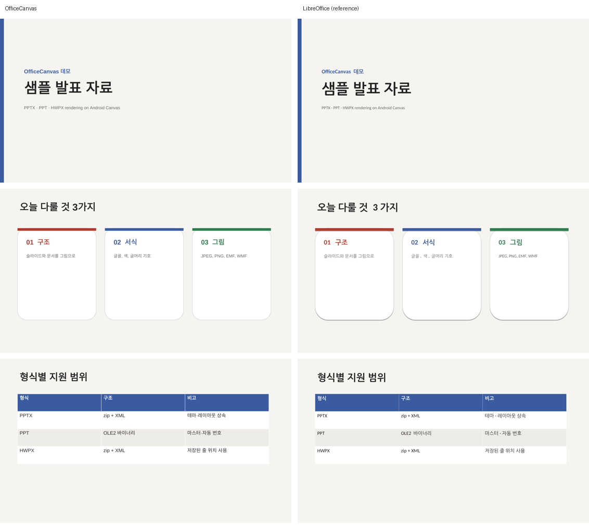

# OfficeCanvas

Render PowerPoint (`.pptx`, `.ppt`), Word (`.docx`) and Hangul (`.hwpx`, `.hwp`) documents to Android `Bitmap`s, on the device, in plain Kotlin. No native code, no server, no dependencies beyond the Android SDK.



## Why

Showing an Office or Hangul document inside an Android app usually means one of three things: upload it to a conversion service, ship a very large native office suite, or pay for a commercial SDK. The common JVM option, Apache POI, renders slides through `java.awt`, which Android does not have.

Slides and Hangul documents have a property that makes a small renderer possible: every shape, and in Hangul documents every line of text, is stored with its final position. PowerPoint saves absolute coordinates for each shape; Hangul saves where each line starts and where each page breaks. So the job is reading those positions back and drawing them, not re-running a word processor's layout engine. Word documents are the exception: they save no layout, so `.docx` is laid out here, with a small layout engine of its own (see below).

## Usage

```kotlin
val pageCount = OfficeCanvas.render(context, file) { index, bitmap ->
    File(outDir, "page$index.png").outputStream().use {
        bitmap.compress(Bitmap.CompressFormat.PNG, 100, it)
    }
    bitmap.recycle()
}
```

- The format is detected from the file's contents (`DocumentFormat.detect(file)`), not its extension.
- Pages are handed over one at a time and never held together, so long decks don't run out of memory. The callback owns each bitmap.
- `longSidePx` (default 1600) sets the size of a page's longer side; the other side follows the page's aspect ratio.
- Rendering is synchronous. Call it off the main thread.
- Anything that isn't a readable PPTX, PPT, DOCX, HWPX or HWP raises `OfficeCanvasException`. Password-protected and distribution-only (배포용) `.hwp` files are encrypted and not supported.
- At most `OfficeCanvas.MAX_PAGES` (1000) pages are rendered.

### Files from other people

Documents are parsed as if they could be hostile, since they usually come from someone else:

- XML parts that carry a DTD are refused, so entity expansion and external entities are closed whichever XML parser the platform provides.
- Sizes and counts read from a file are checked against the data actually present before anything is allocated, every chain or loop in a file is followed at most once, nesting stops at 32 levels, decoded pictures are subsampled to at most 16 million pixels, and output stops at 1000 pages.
- A damaged shape, picture or slide is skipped; anything worse, including running out of memory, comes out as `OfficeCanvasException` rather than an `Error`.

`MaliciousInputTest` holds the crafted files these rules were written against.

The `sample` module is a one-screen app: pick a document and its pages appear in a list.

## Installation

Releases are built by [JitPack](https://jitpack.io/#baeseungwon1010/officecanvas). Add its repository in `settings.gradle.kts`:

```kotlin
dependencyResolutionManagement {
    repositories {
        google()
        mavenCentral()
        maven("https://jitpack.io")
    }
}
```

and the dependency in your module:

```kotlin
dependencies {
    implementation("com.github.baeseungwon1010:officecanvas:0.5.3")
}
```

Any commit hash or `main-SNAPSHOT` works as the version too. To build it yourself instead, run `./gradlew :officecanvas:publishToMavenLocal` and depend on `io.github.baeseungwon1010:officecanvas:0.5.3` from `mavenLocal()`.

Requirements: minSdk 24, Java 17 toolchain. The AAR is about 3 MB, most of it bundled fonts (see below).

## What is rendered

### Slides

| | PPTX | PPT (97–2003) |
|---|---|---|
| Text with size, color, bold/italic/underline | ✓ | ✓ |
| Inheritance from layout / master / theme | ✓ (position, fill, text styles, body properties, color map) | ✓ (title master → master) |
| Theme colors with modifiers (lumMod, tint, shade, …) | ✓ | — (stored as RGB) |
| Shape styles (`<p:style>` fill, line and font references) | ✓ | — |
| Bullets | ✓ | ✓ incl. symbol-font bullets |
| Automatic numbering (1. a. i. …) | ✓ | ✓ |
| Superscript / subscript | ✓ | ✓ |
| Text highlight | ✓ | — |
| Shrink text on overflow | the scale PowerPoint saved | estimated in PowerPoint's own steps |
| Shape fill and outline | ✓ | ✓ |
| Lines, connectors, arrowheads, flipped shapes | ✓ (straight, elbow, curved) | ✓ |
| Shape outlines | ~65 presets + freeforms | freeforms + common presets |
| Gradient fills | linear, radial, rectangular | linear, axial, radial, rectangular |
| Outer shadows | ✓ (shapes, pictures and text, incl. theme effect styles) | — |
| Groups turned and flipped, group fill | ✓ | as the shapes PowerPoint stores |
| 3-D rotation and extrusion | approximated: the shape drawn into its turned plane, the extrusion swept behind it | — |
| Tables | ✓ incl. table styles; rows grow to fit their text | as the shapes PowerPoint stores |
| SmartArt | from the drawing PowerPoint saves with it | — |
| Charts | bar and column (clustered, stacked, 100%), line, area, pie, doughnut, from the values cached in the chart part; title, legend, axis and value labels | — |
| Pictures | PNG, JPEG, EMF, WMF, SVG; crop | PNG, JPEG, EMF, WMF, DIB, TIFF, PICT with embedded JPEG/PNG; crop |
| Slide background | solid, gradient, picture | solid, picture, gradient |
| Hidden slides | skipped | skipped, as PowerPoint's own export does |

Not rendered: scatter, radar and 3-D charts, inner shadows, glow, reflections, bevels and 3-D lighting, animations, video, embedded OLE objects other than their preview picture.

### Hangul documents

| | HWPX | HWP 5.0 |
|---|---|---|
| Lines and page breaks where Hangul saved them | ✓ | ✓ |
| Character styles, several per line (size, color, bold, italic, underline, 장평, 자간, super/subscript) | ✓ | ✓ (and strikethrough) |
| Paragraph alignment (left, right, center, justify, distribute) and tabs | ✓ | ✓ |
| Paragraph numbers, outline numbers and bullets | ✓ | ✓ |
| Fonts | serif or sans-serif chosen from the face name; Latin text in the bundled metric-compatible fonts | same |
| Tables: cell borders, fills, vertical alignment, nested tables | ✓ | ✓ (gradient fills as their average color) |
| Tables continued across pages, rows taller than a page cut between their lines | ✓ | ✓ |
| Equations (Hangul's equation scripts, typeset again into their saved box) | ✓ | ✓ |
| Objects set like characters in a line of text | ✓ | ✓ |
| Pictures | inline and floating; crop | same |
| Headers and footers (odd/even pages, changing mid-section), page numbers and the page number field, pages hiding them, numbering starting over | ✓ | ✓ |
| Drawing objects: lines, rectangles, ellipses, polygons, groups, text boxes | ✓ (arcs and curves through their points) | ✓ |
| Footnotes, charts, multiple columns | — | — |

Some systems still save `.hwp` files in HWPML, Hangul's older XML format. It saves no line positions, so OfficeCanvas lays it out itself: lines broken to the column width with the same faces it draws with, the paragraph's line spacing, alignment and margins, tables (rows as tall as their cells declare or their text needs), tables placed by offsets, and page breaks. Pictures, headers and footers in HWPML are not drawn yet, and its line breaks can differ from Hangul's where the fonts differ.

### Word documents

Word saves no line breaks or page breaks, so a `.docx` is laid out here: lines broken to the column width with the faces the renderer draws with, set at the paragraph's line spacing, and paged with the section's page size and margins. What is laid out and drawn:

| | DOCX |
|---|---|
| Styles: document defaults, table style, paragraph and character style chains, direct formatting; theme fonts | ✓ |
| Character formatting: size, color, bold, italic, underline, strikethrough, super/subscript, caps, hidden text, shading and highlighter | ✓ |
| Paragraphs: alignment, indents (first line, hanging), spacing before and after (dropped at the top of a page the text ran onto, and between paragraphs of one style when they say so), line spacing (multiple, exact, at least) | ✓ |
| Tab stops (left, center, right) and the default stops | ✓ |
| List numbering in Word's formats (decimal, letters, roman, 가나다, ㄱㄴㄷ, ①, 일이삼, bullets) | ✓ |
| Paragraph borders (one box for a run of paragraphs with the same ones) and shading | ✓ |
| Tables: grid, merged cells, borders from the table style and the cells, shading, cell margins, row heights (an exact one cuts off what doesn't fit); header rows repeat and rows break across pages | ✓ |
| Pictures, inline and floating (placed from the page, the margins or their paragraph; text they wrap goes on below them) | ✓ |
| Shapes (rectangles, rounded rectangles, ellipses, lines) with their fill and outline, text boxes, groups; older VML text boxes and pictures | ✓ |
| Equations, typeset from their structure (fractions, scripts, roots, sums and integrals, delimiters, matrices, accents, functions, limits) | ✓ |
| Footnotes at the bottom of their page, endnotes after the text | ✓ |
| Page breaks, keep-with-next, sections with their own page size and orientation, page borders | ✓ |
| Headers and footers: default, first page and even pages, kept from the previous section; PAGE (with its restart and format) and NUMPAGES fields | ✓ |
| Text wrapping beside a floating object, columns, charts, rotated shapes | — |

## Fonts

Office documents are mostly set in Calibri, Arial, Times New Roman and Courier New, and line breaks depend on their exact glyph widths. The library bundles fonts with the same metrics under `assets/officecanvas/fonts` (SIL Open Font License 1.1): Carlito for Calibri (regular and bold; italics are slanted) and Liberation Sans, Serif and Mono for the other three. Text in scripts these fonts don't cover, such as Hangul, falls back to the device's system fonts, so its line breaks can differ slightly from the original.

## How close is it

Both slide formats are checked page by page against LibreOffice's PDF output of the same file. For `.pptx`, on 34 real decks (447 slides of lectures, reports and team presentations), the mean per-slide difference score from `tools/compare_render.py` is 1.8; on the first 15 of them it was 6.1 before table styles, theme style references, inherited backgrounds and placeholders, SVG icons and Carlito were added. Most of what remains is Hangul set in different fallback fonts (LibreOffice also spaces Hangul and Latin apart) and 3-D perspective. For `.ppt`, on a 75-slide lecture deck, 64 slides have every text baseline within 6 pt of LibreOffice's; most of the others are text shrunk to fit, which follows PowerPoint's steps rather than LibreOffice's way. Hangul documents were compared the same way on 18 real `.hwp` and 11 `.hwpx` documents (about 170 pages of forms, reports, handbooks and lecture notes) against LibreOffice with the H2Orestart import filter. That reference lays text out again with its own metrics instead of using the saved line positions, so it differs from Hangul too; the comparison is used to find missing features rather than to score. Word documents were compared the same way on 80 real `.docx` files (1,733 pages of forms, write-ups, notes and problem sets): the page count matches LibreOffice's in 45 of them and is within 10 % in 71. Another 65 `.docx` files, the Hangul documents above exported to Word by LibreOffice (text boxes, floating pictures and equations throughout), match in 31 and are within 10 % in 59. None of these documents are included here, for copyright and privacy reasons. `tools/compare.sh` runs the same comparison on any document; see [docs/TESTING.md](docs/TESTING.md).

LibreOffice is a reference, not ground truth. Where PowerPoint and LibreOffice disagree (symbol fonts, automatic numbering), the renderer follows PowerPoint.

## Documentation

- [docs/ARCHITECTURE.md](docs/ARCHITECTURE.md): packages, data flow, and where to add a format feature
- [docs/FORMAT_NOTES.md](docs/FORMAT_NOTES.md): what the files actually contain, and the traps found while reading them
- [docs/TESTING.md](docs/TESTING.md): test documents, how they're generated, and the comparison tools

## 한국어 소개

OfficeCanvas는 PPTX·PPT·DOCX·HWPX·HWP 문서를 안드로이드 기기 안에서 바로 이미지로 그리는 Kotlin 라이브러리입니다. 변환 서버나 네이티브 라이브러리 없이 동작합니다. 슬라이드와 한글 문서는 도형·줄의 최종 위치가 파일 안에 저장되어 있어서, 워드프로세서의 레이아웃 엔진을 다시 구현하지 않고도 원본과 거의 같은 모양을 그릴 수 있습니다. HWPX와 HWP는 한글이 저장해 둔 줄 위치(`<hp:lineseg>`, `PARA_LINE_SEG`)와 쪽 나눔을 그대로 사용합니다. 줄 위치를 저장하지 않는 옛 XML 형식(HWPML)으로 저장된 `.hwp`는 직접 줄과 쪽을 나눠 그립니다. Word 문서(`.docx`)도 줄 위치를 저장하지 않으므로 스타일·번호 목록·표·그림·글상자·수식·각주·머리말과 꼬리말을 읽어 직접 줄과 쪽을 나눠 그립니다. JitPack 저장소를 추가하고 `com.github.baeseungwon1010:officecanvas:0.5.3`을 의존성으로 넣은 뒤, 위의 `OfficeCanvas.render` 한 줄로 사용합니다. 암호가 걸린 문서와 배포용 문서는 암호화되어 있어 열 수 없습니다.

## License

Apache License 2.0, see [LICENSE](LICENSE). The bundled Liberation fonts are under the SIL Open Font License 1.1; see [NOTICE](NOTICE).
